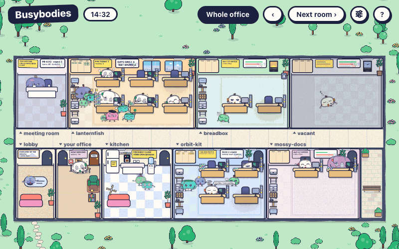

# Busybodies

Your AI coding agents, as a little office. Every coding-agent session gets a desk, every subagent
it spawns gets a tiny colleague, and you can watch them work frantically, slack off shamelessly,
and wave at you when they need you.



*An invented afternoon (`?demo`): every project, title and colleague here is made up.*

## Install

Busybodies runs on Apple Silicon Macs (macOS 14 or later). Builds aren't signed by Apple yet, so
the install script is the smooth way in. Read it first if you like; [`install.sh`](install.sh) is
about 70 lines.

```bash
curl -fsSL https://raw.githubusercontent.com/MrMint/busybodies/main/install.sh | sh
```

It downloads the latest release, checks it against the release's `SHA256SUMS`, and puts
`Busybodies.app` in `/Applications` (or `~/Applications`), without `sudo`. Pin a version with
`... | sh -s -- 0.1.0`.

If macOS won't open it the first time (it can't verify an unsigned app), open **System Settings →
Privacy & Security** and click **Open Anyway** next to Busybodies. That's needed once.

<details><summary>The <code>.dmg</code>, updates and uninstalling</summary>

**The `.dmg`.** Each [release](https://github.com/MrMint/busybodies/releases) also has
`Busybodies-macos-arm64.dmg`. A browser download is quarantined, and macOS blocks an app it can't
verify, so it takes one extra step: open the `.dmg`, drag Busybodies into Applications, open it
and click **Done** on the warning, then click **Open Anyway** in **System Settings → Privacy &
Security**. Or clear the flag yourself: `xattr -dr com.apple.quarantine /Applications/Busybodies.app`.

**Updates.** The app checks for a new release a little after launch and every 6 hours, and
restarts into it. `BUSYBODIES_NO_UPDATE=1` turns that off.

**Uninstall.**

```bash
rm -rf /Applications/Busybodies.app ~/Library/Application\ Support/app.busybodies ~/Library/WebKit/app.busybodies
```

</details>

## What it shows

- **Rooms are projects**, off a hallway. **Desks are sessions**; a busy project fills rows of
  them. **Subagents** stand in a row at their session's desk, smaller the deeper they're nested.
- Busy agents type frantically; idle ones put their feet up, spin their chairs or scroll their
  phones; finished ones queue for coffee and go home. Reviews happen in the meeting room. A session **waiting on you** holds
  up a sign, and its room pulses.
- Click a room to zoom in, then a desk. **Escape** shows the whole office; **n** and **p** step
  through the rooms.
- **The menu bar** shows a mochi face: busy, all idle, or someone waiting on you. Its menu opens
  the office, **compact mode** (a small floating window that stays on top; also **⌘⌥B**), the
  theme, About, and Quit. Closing the office window keeps Busybodies in the menu bar.
- **Sound** (off until you turn it on in the menu): a desk bell when someone starts waiting on
  you, a stamp for a green test, a sad two-note for a red one, a paper rustle for a compaction, a
  chime for a PR, and the copier grinding through a long build, over a very quiet room tone. All
  made in code, never more than one of a kind every few seconds, and silent while the window is
  off screen. **Calm office** in the same menu stops the cast's idle fidgeting and the sound
  (your system's Reduce motion setting does the same). With sound on, a character also speaks
  on the beats that matter (waiting on you, done, back to work), at most a few lines a minute: a
  line with a time or a name in it is cute babble made on your machine, and the rest are voices
  recorded ahead of time with an AI text-to-speech model and shipped with the app. Nothing is
  sent anywhere to make them.

## What it reads, and privacy

Busybodies reads your coding agent's own local files: its list of running sessions, their
transcripts and its subagents' details, plus the `.git` pointer and `HEAD` of each live session's
folder, to group worktrees with their repository and show the branch. It reads them **read-only**: it never writes to them or
changes the agent's settings. The one exception is the optional "waiting on you" hook
(`tools/hooks.ts`), and only if you install it yourself.

**Nothing you're working on leaves your machine.** The only network request is the update check
against this project's GitHub Releases. There are no analytics and no accounts.

If it finds no coding agent, it says so and tells you where it looked. Set
`BUSYBODIES_AGENT_HOME` to point it elsewhere.

## Build from source

Install [Hutch](https://docs.electrobun.dev/electrobun/guides/hutch/), then:

```bash
hutch install      # dependencies, from hutch.lock
hutch run dev      # build and open the app, rebuilding on change
hutch run dev:hmr  # the same, with Vite hot reload for the scene
hutch run build    # a release build, in build/ and artifacts/
```

`hutch pm exec -- vite` serves the scene in any browser: open it with `?demo` for the invented
afternoon. [`AGENTS.md`](AGENTS.md) has the checks to run before a change, and
[`docs/decisions.md`](docs/decisions.md) says why things are the way they are.

## How it works

A watcher in the Bun process reads the agent tool's files and keeps a live tree of sessions and
agents. PixiJS draws the office on WebGL2, and only while something moves: an idle office costs
nothing. A director turns each change into acting (who walks where, which pose), characters are
mochi-shaped cut-paper puppets posed from a part vocabulary, and a line bank supplies the sass.
It's built on [Electrobun](https://electrobun.dev) and MIT licensed.
